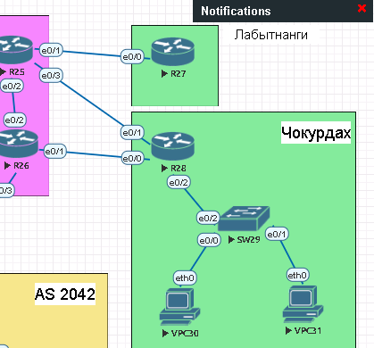

#  PBR

#  Цель:
настроить политику маршрутизации в офисе Чокурдах и распределить трафик между двумя линками.

###  Задание:

  1. Настроите политику маршрутизации для сетей офиса.
  2. Распределите трафик между двумя линками с провайдером.
  3. Настроите отслеживание линка через технологию IP SLA.(только для IPv4)
  4. Настройте для офиса Лабытнанги маршрут по-умолчанию.

## Схема лабораторной работы:


###  Таблица IP адресации

| Устройство  | Интерфейс | Адрес              | Шлюз                | 
|-----|------|--------------------------|------------------------|
| Триада | |                |           |      
|R25 |e0/1 | 20.20.0.229      |           | 
|    |e0/3 | 20.20.0.225      |           | 
|R26 |e0/1 | 20.20.0.233      |           | 
| Чокурдах | |                |           |      
|R28 |e0/0 | 20.20.0.234      | 20.20.0.233  | 
|    |e0/1 | 20.20.0.226      | 20.20.0.225 | 
| Лабытнанги | |                |           |      
|R27 |e0/0 | 20.20.0.230      | 20.20.0.229  | 

###  Настройка IP SLA
Доступность R26
```
R28(config)#ip sla 1
R28(config-ip-sla)#icmp-echo 20.20.0.233 source-interface e0/0
R28(config-ip-sla-echo)#timeout 5000
R28(config-ip-sla-echo)#frequency 5
R28(config-ip-sla-echo)#ip sla schedule 1 life forever start-time now
```
Создаем трек, который будет отслеживать SLA 1
```
R28(config)#track 1 ip sla 1 reachability
```
Доступность R25
```
R28(config)#ip sla 2
R28(config-ip-sla)#icmp-echo 20.20.0.225 source-interface e0/1
R28(config-ip-sla-echo)#timeout 5000
R28(config-ip-sla-echo)#frequency 5
R28(config-ip-sla-echo)#ip sla schedule 2 life forever start-time now
```
Создаем трек, который будет отслеживать SLA 2
```
R28(config)#track 2 ip sla 2 reachability
```
Создаем маршруты по умолчанию
```
R28(config)#ip route 0.0.0.0 0.0.0.0 20.20.0.233 track 1
R28(config)#ip route 0.0.0.0 0.0.0.0 20.20.0.225 10 track 2
```
