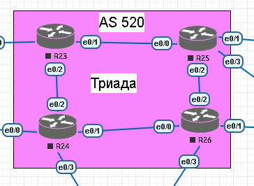

#  IS-IS

#  Цель:
настроить протокол IS-IS для IPv4 и IPv6 в ISP Триада.

###  Задание:
  1. Настроите IS-IS в ISP Триада.
  2. R23 и R25 находятся в зоне 2222.
  3. R24 находится в зоне 24.
  4. R26 находится в зоне 26.

## Схема лабораторной работы:


####  Net адреса маршрутизаторов

| Устройство  | Интерфейс | Адрес              | NET |
|-----|------|--------------------------|------------------------|
|R23 |loopback 0| 192.168.0.97     |49.2222.1921.6800.0097.00           |
|R24 |loopback 0| 192.168.0.99     |49.0024.1921.6800.0099.00           |
|R25 |loopback 0| 192.168.0.98     |49.2222.1921.6800.0098.00           |
|R26 |loopback 0| 192.168.0.100    |49.0026.1921.6800.0100.00           |

####  Настройка Роутеров R23 и R25 в зоне 2222
```
R23(config)#router isis 1
R23(config-router)#net 49.2222.1921.6800.0097.00
R23(config-router)#int loopback 0
R23(config-if)#ip router isis 1
R23(config-if)#int e0/1
R23(config-if)#ip router isis 1
R23(config-if)#int e0/2
R23(config-if)#ip router isis 1

R25(config)#router isis 1
R25(config-router)#net 49.2222.1921.6800.0098.00
R25(config-router)#int loopback 0
R25(config-if)#ip router isis 1
R25(config-if)#int e0/0
R25(config-if)#ip router isis 1
R25(config-if)#int e0/2
R25(config-if)#ip router isis 1
```

####  Настройка Роутера R24 в зоне 24
```
R24(config)#Router isis 1
R24(config-router)#net 49.0024.1921.6800.0099.00
R24(config-router)#int e0/1
R24(config-if)#ip router isis 1
R24(config-if)#int e0/2
R24(config-if)#ip router isis 1
```

####  Настройка Роутера R26 в зоне 26
```
R26(config)#Router isis 1
R26(config-router)#net 49.0026.1921.6800.0100.00
R26(config-router)#int e0/0
R26(config-if)#ip router isis 1
R26(config-if)#int e0/2
R26(config-if)#ip router isis 1
```

####  Просматриваем параметры ISIS на R23
```
R23#show isis neighbors

Tag 1:
System Id      Type Interface   IP Address      State Holdtime Circuit Id
R25            L1   Et0/1       20.20.0.206     UP    9        R25.01
R25            L2   Et0/1       20.20.0.206     UP    9        R25.01
R24            L2   Et0/2       20.20.0.202     UP    9        R24.02
R23#sh isis topology

Tag 1:
IS-IS TID 0 paths to level-1 routers
System Id            Metric     Next-Hop             Interface   SNPA
R23                  --
R25                  10         R25                  Et0/1       aabb.cc01.9000

IS-IS TID 0 paths to level-2 routers
System Id            Metric     Next-Hop             Interface   SNPA
R23                  --
R25                  10         R25                  Et0/1       aabb.cc01.9000
R24                  10         R24                  Et0/2       aabb.cc01.8020
R26                  20         R25                  Et0/1       aabb.cc01.9000
                                R24                  Et0/2       aabb.cc01.8020
```

####  Просматриваем параметры ISIS на R24
```
R24#show isis neighbors

Tag 1:
System Id      Type Interface   IP Address      State Holdtime Circuit Id
R23            L2   Et0/2       20.20.0.201     UP    27       R24.02
R26            L2   Et0/1       20.20.0.218     UP    9        R26.01
R24#show isis topol

Tag 1:
IS-IS TID 0 paths to level-1 routers
System Id            Metric     Next-Hop             Interface   SNPA
R24                  --

IS-IS TID 0 paths to level-2 routers
System Id            Metric     Next-Hop             Interface   SNPA
R23                  10         R23                  Et0/2       aabb.cc01.7020
R25                  20         R23                  Et0/2       aabb.cc01.7020
                                R26                  Et0/1       aabb.cc01.a000
R24                  --
R26                  10         R26                  Et0/1       aabb.cc01.a000
```

####  Просматриваем параметры ISIS на R25
```
R25#show isis neighbors

Tag 1:
System Id      Type Interface   IP Address      State Holdtime Circuit Id
R23            L1   Et0/0       20.20.0.205     UP    25       R25.01
R23            L2   Et0/0       20.20.0.205     UP    20       R25.01
R26            L2   Et0/2       20.20.0.222     UP    8        R26.02
R25#show isis topology

Tag 1:
IS-IS TID 0 paths to level-1 routers
System Id            Metric     Next-Hop             Interface   SNPA
R23                  10         R23                  Et0/0       aabb.cc01.7010
R25                  --

IS-IS TID 0 paths to level-2 routers
System Id            Metric     Next-Hop             Interface   SNPA
R23                  10         R23                  Et0/0       aabb.cc01.7010
R25                  --
R24                  20         R23                  Et0/0       aabb.cc01.7010
                                R26                  Et0/2       aabb.cc01.a020
R26                  10         R26                  Et0/2       aabb.cc01.a020
```
####  Просматриваем параметры ISIS на R26
```
R26#show isis neighbors

Tag 1:
System Id      Type Interface   IP Address      State Holdtime Circuit Id
R25            L2   Et0/2       20.20.0.221     UP    23       R26.02
R24            L2   Et0/0       20.20.0.217     UP    27       R26.01
R26#show isis topology

Tag 1:
IS-IS TID 0 paths to level-1 routers
System Id            Metric     Next-Hop             Interface   SNPA
R26                  --

IS-IS TID 0 paths to level-2 routers
System Id            Metric     Next-Hop             Interface   SNPA
R23                  20         R25                  Et0/2       aabb.cc01.9020
                                R24                  Et0/0       aabb.cc01.8010
R25                  10         R25                  Et0/2       aabb.cc01.9020
R24                  10         R24                  Et0/0       aabb.cc01.8010
R26                  --
```
