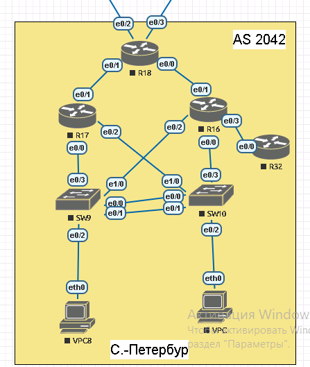

#  EIGRP

#  Цель:
настроить EIGRP named-mode для IPv4 и IPv6 в офисе С.-Петербург.

###  Задание:
  1. В офисе С.-Петербург настроить EIGRP.
  2. R32 получает только маршрут по умолчанию.
  3. R16-17 анонсируют только суммарные префиксы.
  4. Использовать EIGRP named-mode для настройки сети.
  5. Настройка осуществляется одновременно для IPv4 и IPv6.
  
## Схема лабораторной работы:

