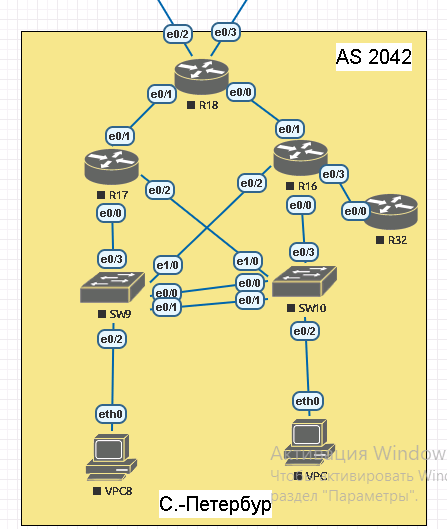

#  EIGRP

#  Цель:
настроить EIGRP named-mode для IPv4 и IPv6 в офисе С.-Петербург.

###  Задание:
  1. В офисе С.-Петербург настроить EIGRP.
  2. R32 получает только маршрут по умолчанию.
  3. R16-17 анонсируют только суммарные префиксы.
  4. Использовать EIGRP named-mode для настройки сети.
  5. Настройка осуществляется одновременно для IPv4 и IPv6.
  
## Схема лабораторной работы:


####  R16
```
R16(config)#router eigrp 1
R16(config-router)#router-id 16.16.16.16
R16(config-router)#network 20.20.0.40 0.0.0.3
R16(config-router)#network 20.20.0.36 0.0.0.3
R16(config-router)#network 192.168.3.0 0.0.0.255
R16(config-router)#network 192.168.4.0 0.0.0.255
R16(config-router)#network 192.168.0.32 0.0.0.31
R16(config-router)#network 192.168.100.0 0.0.0.255
R16(config-router)#auto-summary
R16(config-router)#passive-interface default
R16(config-router)#no passive-interface Loopback0
R16(config-router)#no passive-interface Ethernet0/0.30
R16(config-router)#no passive-interface Ethernet0/0.40
R16(config-router)#no passive-interface Ethernet0/2.100
R16(config-router)#no passive-interface Ethernet0/1
R16(config-router)#no passive-interface Ethernet0/3
```

####  R17
```
R17(config)#router eigrp 1
R17(config-router)##router-id 17.17.17.17
R17(config-router)#network 20.20.0.32 0.0.0.3
R17(config-router)#network 192.168.3.0 0.0.0.255
R17(config-router)#network 192.168.4.0 0.0.0.255
R17(config-router)#network 192.168.0.0 0.0.0.31
R17(config-router)#network 192.168.100.0 0.0.0.255
R17(config-router)#auto-summary
R17(config-router)#passive-interface default
R17(config-router)#no passive-interface Loopback0
R17(config-router)#no passive-interface Ethernet0/0.30
R17(config-router)#no passive-interface Ethernet0/0.40
R17(config-router)#no passive-interface Ethernet0/2.100
R17(config-router)#no passive-interface Ethernet0/1
```

####  R18
```
R18(config)#router eigrp 1
R18(config-router)#router-id 18.18.18.18
R18(config-router)#network 20.20.0.36 0.0.0.3
R18(config-router)#network 20.20.0.32 0.0.0.3
R18(config-router)#network 20.20.0.212 0.0.0.3
R18(config-router)#network 20.20.0.236 0.0.0.3
R18(config-router)#network 192.168.0.0 0.0.0.31
R18(config-router)#no auto-summary
```

####  R32
```
R32(config)#router eigrp 1
R32(config-router)#router-id 32.32.32.32
R32(config-router)#network 0.0.0.0 0.0.0.0
R32(config-router)#no auto-summary
R32(config-router)#passive-interface default
R32(config-router)#no passive-interface Loopback0
R32(config-router)#no passive-interface Ethernet0/0
```

### Проверка состояния EIGRP и вывод маршрутов роутеров

####  R16
```
R16#show ip eigrp neighbors
EIGRP-IPv4 Neighbors for AS(1)
H   Address                 Interface              Hold Uptime   SRTT   RTO  Q  Seq
                                                   (sec)         (ms)       Cnt Num
1   20.20.0.42              Et0/3                    12 00:23:12    8   100  0  4
0   20.20.0.37              Et0/1                    12 00:23:12 1600  5000  0  6
R16#show ip route
Codes: L - local, C - connected, S - static, R - RIP, M - mobile, B - BGP
       D - EIGRP, EX - EIGRP external, O - OSPF, IA - OSPF inter area
       N1 - OSPF NSSA external type 1, N2 - OSPF NSSA external type 2
       E1 - OSPF external type 1, E2 - OSPF external type 2
       i - IS-IS, su - IS-IS summary, L1 - IS-IS level-1, L2 - IS-IS level-2
       ia - IS-IS inter area, * - candidate default, U - per-user static route
       o - ODR, P - periodic downloaded static route, H - NHRP, l - LISP
       a - application route
       + - replicated route, % - next hop override

Gateway of last resort is not set

      20.0.0.0/8 is variably subnetted, 8 subnets, 3 masks
D        20.0.0.0/8 is a summary, 00:24:10, Null0
D        20.20.0.32/30 [90/307200] via 20.20.0.37, 00:24:06, Ethernet0/1
C        20.20.0.36/30 is directly connected, Ethernet0/1
L        20.20.0.38/32 is directly connected, Ethernet0/1
C        20.20.0.40/30 is directly connected, Ethernet0/3
L        20.20.0.41/32 is directly connected, Ethernet0/3
D        20.20.0.212/30 [90/307200] via 20.20.0.37, 00:24:06, Ethernet0/1
D        20.20.0.236/30 [90/307200] via 20.20.0.37, 00:24:06, Ethernet0/1
      192.168.0.0/24 is variably subnetted, 3 subnets, 3 masks
D        192.168.0.0/24 is a summary, 00:24:10, Null0
C        192.168.0.32/27 is directly connected, Loopback0
L        192.168.0.35/32 is directly connected, Loopback0
      192.168.3.0/24 is variably subnetted, 2 subnets, 2 masks
C        192.168.3.0/24 is directly connected, Ethernet0/0.30
L        192.168.3.3/32 is directly connected, Ethernet0/0.30
      192.168.4.0/24 is variably subnetted, 2 subnets, 2 masks
C        192.168.4.0/24 is directly connected, Ethernet0/0.40
L        192.168.4.3/32 is directly connected, Ethernet0/0.40
      192.168.100.0/24 is variably subnetted, 2 subnets, 2 masks
C        192.168.100.0/24 is directly connected, Ethernet0/2.100
L        192.168.100.35/32 is directly connected, Ethernet0/2.100
```

####  R17
```
R17#show ip eigrp neighbors
EIGRP-IPv4 Neighbors for AS(1)
H   Address                 Interface              Hold Uptime   SRTT   RTO  Q  Seq
                                                   (sec)         (ms)       Cnt Num
0   20.20.0.33              Et0/1                    14 00:25:30 1597  5000  0  7
R17#show ip route
Codes: L - local, C - connected, S - static, R - RIP, M - mobile, B - BGP
       D - EIGRP, EX - EIGRP external, O - OSPF, IA - OSPF inter area
       N1 - OSPF NSSA external type 1, N2 - OSPF NSSA external type 2
       E1 - OSPF external type 1, E2 - OSPF external type 2
       i - IS-IS, su - IS-IS summary, L1 - IS-IS level-1, L2 - IS-IS level-2
       ia - IS-IS inter area, * - candidate default, U - per-user static route
       o - ODR, P - periodic downloaded static route, H - NHRP, l - LISP
       a - application route
       + - replicated route, % - next hop override

Gateway of last resort is not set

      20.0.0.0/8 is variably subnetted, 7 subnets, 3 masks
D        20.0.0.0/8 is a summary, 00:25:50, Null0
C        20.20.0.32/30 is directly connected, Ethernet0/1
L        20.20.0.34/32 is directly connected, Ethernet0/1
D        20.20.0.36/30 [90/307200] via 20.20.0.33, 00:25:46, Ethernet0/1
D        20.20.0.40/30 [90/332800] via 20.20.0.33, 00:25:46, Ethernet0/1
D        20.20.0.212/30 [90/307200] via 20.20.0.33, 00:25:46, Ethernet0/1
D        20.20.0.236/30 [90/307200] via 20.20.0.33, 00:25:46, Ethernet0/1
      192.168.0.0/24 is variably subnetted, 3 subnets, 3 masks
D        192.168.0.0/24 [90/435200] via 20.20.0.33, 00:25:46, Ethernet0/1
C        192.168.0.32/27 is directly connected, Loopback0
L        192.168.0.34/32 is directly connected, Loopback0
      192.168.3.0/24 is variably subnetted, 2 subnets, 2 masks
C        192.168.3.0/24 is directly connected, Ethernet0/0.30
L        192.168.3.2/32 is directly connected, Ethernet0/0.30
      192.168.4.0/24 is variably subnetted, 2 subnets, 2 masks
C        192.168.4.0/24 is directly connected, Ethernet0/0.40
L        192.168.4.2/32 is directly connected, Ethernet0/0.40
      192.168.100.0/24 is variably subnetted, 2 subnets, 2 masks
C        192.168.100.0/24 is directly connected, Ethernet0/2.100
L        192.168.100.34/32 is directly connected, Ethernet0/2.100
```

####  R18
```
R18#show ip eigrp neighbors
EIGRP-IPv4 Neighbors for AS(1)
H   Address                 Interface              Hold Uptime   SRTT   RTO  Q  Seq
                                                   (sec)         (ms)       Cnt Num
1   20.20.0.38              Et0/0                    14 00:26:50    2   100  0  6
0   20.20.0.34              Et0/1                    14 00:26:50    1   100  0  3
R18#show ip route
Codes: L - local, C - connected, S - static, R - RIP, M - mobile, B - BGP
       D - EIGRP, EX - EIGRP external, O - OSPF, IA - OSPF inter area
       N1 - OSPF NSSA external type 1, N2 - OSPF NSSA external type 2
       E1 - OSPF external type 1, E2 - OSPF external type 2
       i - IS-IS, su - IS-IS summary, L1 - IS-IS level-1, L2 - IS-IS level-2
       ia - IS-IS inter area, * - candidate default, U - per-user static route
       o - ODR, P - periodic downloaded static route, H - NHRP, l - LISP
       a - application route
       + - replicated route, % - next hop override

Gateway of last resort is not set

      20.0.0.0/8 is variably subnetted, 9 subnets, 2 masks
C        20.20.0.32/30 is directly connected, Ethernet0/1
L        20.20.0.33/32 is directly connected, Ethernet0/1
C        20.20.0.36/30 is directly connected, Ethernet0/0
L        20.20.0.37/32 is directly connected, Ethernet0/0
D        20.20.0.40/30 [90/307200] via 20.20.0.38, 00:27:07, Ethernet0/0
C        20.20.0.212/30 is directly connected, Ethernet0/2
L        20.20.0.214/32 is directly connected, Ethernet0/2
C        20.20.0.236/30 is directly connected, Ethernet0/3
L        20.20.0.238/32 is directly connected, Ethernet0/3
      192.168.0.0/24 is variably subnetted, 3 subnets, 3 masks
D        192.168.0.0/24 [90/409600] via 20.20.0.38, 00:27:07, Ethernet0/0
C        192.168.0.32/27 is directly connected, Loopback0
L        192.168.0.39/32 is directly connected, Loopback0
D     192.168.3.0/24 [90/307200] via 20.20.0.38, 00:27:07, Ethernet0/0
                     [90/307200] via 20.20.0.34, 00:27:07, Ethernet0/1
D     192.168.4.0/24 [90/307200] via 20.20.0.38, 00:27:07, Ethernet0/0
                     [90/307200] via 20.20.0.34, 00:27:07, Ethernet0/1
D     192.168.100.0/24 [90/307200] via 20.20.0.38, 00:27:07, Ethernet0/0
                       [90/307200] via 20.20.0.34, 00:27:07, Ethernet0/1
```

####  R17
```
R32#show ip eigrp neighbors
EIGRP-IPv4 Neighbors for AS(1)
H   Address                 Interface              Hold Uptime   SRTT   RTO  Q  Seq
                                                   (sec)         (ms)       Cnt Num
0   20.20.0.41              Et0/0                    13 00:28:52    6   100  0  5
R32#show ip route
Codes: L - local, C - connected, S - static, R - RIP, M - mobile, B - BGP
       D - EIGRP, EX - EIGRP external, O - OSPF, IA - OSPF inter area
       N1 - OSPF NSSA external type 1, N2 - OSPF NSSA external type 2
       E1 - OSPF external type 1, E2 - OSPF external type 2
       i - IS-IS, su - IS-IS summary, L1 - IS-IS level-1, L2 - IS-IS level-2
       ia - IS-IS inter area, * - candidate default, U - per-user static route
       o - ODR, P - periodic downloaded static route, H - NHRP, l - LISP
       a - application route
       + - replicated route, % - next hop override

Gateway of last resort is not set

      20.0.0.0/8 is variably subnetted, 6 subnets, 2 masks
D        20.20.0.32/30 [90/332800] via 20.20.0.41, 00:29:06, Ethernet0/0
D        20.20.0.36/30 [90/307200] via 20.20.0.41, 00:29:09, Ethernet0/0
C        20.20.0.40/30 is directly connected, Ethernet0/0
L        20.20.0.42/32 is directly connected, Ethernet0/0
D        20.20.0.212/30 [90/332800] via 20.20.0.41, 00:29:06, Ethernet0/0
D        20.20.0.236/30 [90/332800] via 20.20.0.41, 00:29:06, Ethernet0/0
      192.168.0.0/24 is variably subnetted, 3 subnets, 3 masks
D        192.168.0.0/24 [90/409600] via 20.20.0.41, 00:29:09, Ethernet0/0
C        192.168.0.32/27 is directly connected, Loopback0
L        192.168.0.36/32 is directly connected, Loopback0
D     192.168.3.0/24 [90/307200] via 20.20.0.41, 00:29:09, Ethernet0/0
D     192.168.4.0/24 [90/307200] via 20.20.0.41, 00:29:09, Ethernet0/0
D     192.168.100.0/24 [90/307200] via 20.20.0.41, 00:29:09, Ethernet0/0
```
