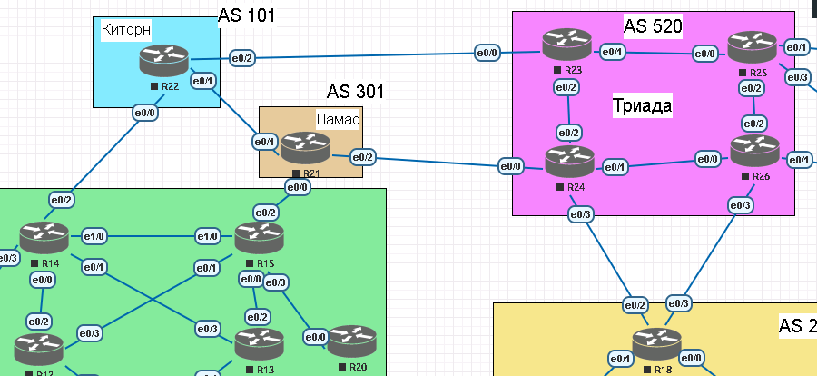

#  BGP. Основы

#  Цель:
настроить BGP между автономными системами и организовать доступность между офисами Москва и С.-Петербург.

###  Задание:
  1. Настроите eBGP между офисом Москва и двумя провайдерами - Киторн и Ламас.
  2. Настроите eBGP между провайдерами Киторн и Ламас.
  3. Настроите eBGP между Ламас и Триада.
  4. Настроите eBGP между офисом С.-Петербург и провайдером Триада.
  5. Организуете IP доступность между пограничным роутерами офисами Москва и С.-Петербург.

